<div align="center">

<h3><code>ashish@github ~ $ ./contributions.sh</code></h3>


<br><br>

<h3><code>ashish@github ~ $ whoami</code></h3>
<table>
  <tr>
    <td valign="top"></td>
    <td valign="top"></td>
  </tr>
</table>

<br><br>

<h3><code>ashish@github ~ $ ./links.sh</code></h3>

**Full Stack Developer · Freelancer · React & Next.js**

[](https://ashishupadhyay.me/)
[](https://www.linkedin.com/in/ashish-kumar-upadhyay-071499284)
[](mailto:ashishkumarupadhyay0328@gmail.com)
[](https://github.com/Ashish-kumar-upadhyay)

</div>

---

### Featured projects

| Project | Stack | Link |
| --- | --- | --- |
| Dubai Perfume E-Commerce | Next.js · MongoDB · Vercel | [noamani.com](https://www.noamani.com/) |
| LMS Platform | React · Firebase | [learnxplatform.qzz.io](https://learnxplatform.qzz.io/) |
| Kitchen Recipe App | React · Firebase · Vite | [Live](https://recpie-kitchen.vercel.app/) · [GitHub](https://github.com/Ashish-kumar-upadhyay/recpie-kitchen) |

---

<details>
<summary><code>ashish@github ~ $ cat README.md --regenerate</code></summary>

Portrait and info card (when you change photo or bio):

```bash
python -m venv .venv
.venv\Scripts\activate
pip install -r scripts/requirements.txt
python scripts/prep_photo.py assets/profile.png source-prepped.png
python scripts/make_ascii_svg.py source-prepped.png profile-ascii.svg
python scripts/make_info_card.py
```

Contribution heatmap (also runs daily via GitHub Actions):

```bash
pip install requests beautifulsoup4
python scripts/fetch_contributions.py
python scripts/render_heatmap_svg.py
```

</details>
